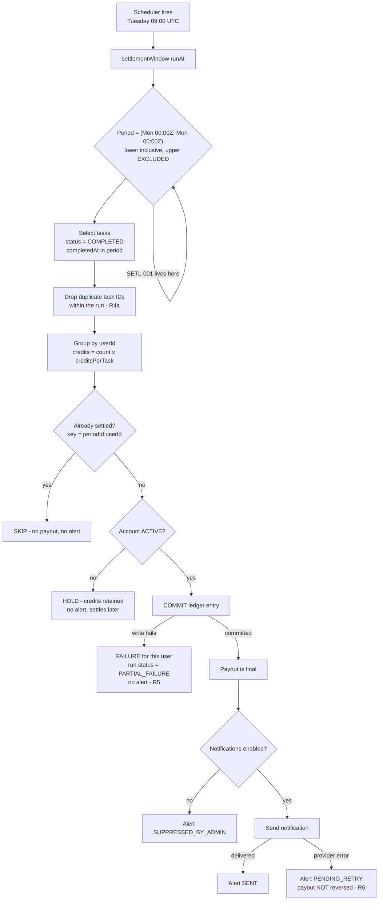

# Flow map — weekly settlement

## The run, step by step



The ordering is the point. Money is committed at **K**, and every branch after
that leaves the payout intact. Nothing downstream of the ledger write can take
it back.

## Where each candidate failure attaches

| Node | Failure it admits | Guarded by |
|---|---|---|
| **C** | Boundary computed in local time, or upper bound inclusive | **SETL-001** — TC-05 to TC-08 |
| E | Upstream re-emits a task ID, paid twice | TC-09 |
| G | Idempotency keyed on run attempt rather than period, retry double-pays | TC-10, TC-11 |
| I | Suspended account paid, or earnings silently destroyed | TC-13 |
| K→L | One bad write aborts the whole batch, or leaves no resume path | TC-11 |
| P→R | Notification wrapped in the payout transaction, provider error rolls back money | TC-12 |
| (cross-run) | A task covered by an earlier ledger entry is paid again | TC-15 |

## The nine-hour shift, drawn

Run at Tue 2026-11-03 09:00 UTC.

```
                Sun 25         Mon 26                      Sun 01         Mon 02
                15:00          00:00                       15:00          00:00
                  |              |                           |              |
intended          |              [===========================================)
                  |              |  period SETL-2026-10-26   |              |
                  |              |                           |              |
actual (faulty)   [=========================================]                |
                  |                                          |              |
                  ^^^^^^^^^^^^^^^                            ^^^^^^^^^^^^^^^^
                  dragged in from              dropped from this period:
                  the previous period:         user not paid, no alert,
                  task paid a SECOND time      lands in next week's run
```

Both error bands are nine hours wide and both appear on every single run.
