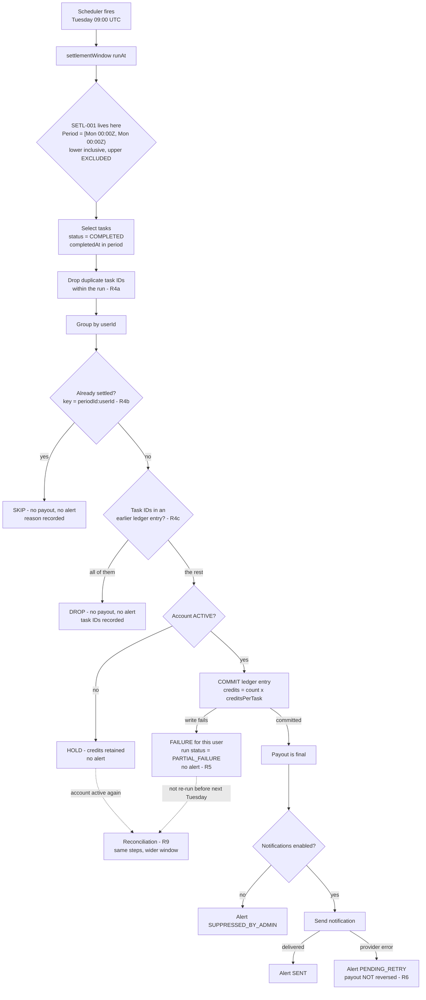

# Flow map — weekly settlement

## The run, step by step



The ordering is the point. Money is committed at **K**, and every branch after
that leaves the payout intact. Nothing downstream of the ledger write can take
it back.

The dotted lines matter just as much. **J** and **L** do not rejoin the next
weekly run, because its window has moved on. Without reconciliation they end
there.

## Where each candidate failure attaches

| Node | Failure it admits | Guarded by |
|---|---|---|
| **C** | Boundary computed in local time, or upper bound inclusive | **SETL-001** — TC-05 to TC-08 |
| E | Upstream re-emits a task ID, paid twice | TC-09 |
| G | Idempotency keyed on run attempt rather than period, retry double-pays | TC-10, TC-11 |
| G2 | A task ID is paid again in a later period | TC-15, TC-20 |
| I | Suspended account paid, or earnings silently destroyed | TC-13, TC-19 |
| K→L | One bad write aborts the whole batch, or leaves no resume path | TC-11, TC-19 |
| P→R | Notification wrapped in the payout transaction, provider error rolls back money | TC-12 |
| S | The band left behind when the fix ships | TC-18 |

## The nine-hour shift, drawn

Run at Tue 2026-11-03 09:00 UTC.

```
                Sun 25         Mon 26                      Sun 01         Mon 02
                15:00          00:00                       15:00          00:00
                  |              |                           |              |
intended          |              [===========================================)
                  |              |  period SETL-2026-10-26   |              |
                  |              |                           |              |
actual (faulty)   [=========================================]                |
                  |                                          |              |
                  ^^^^^^^^^^^^^^^                            ^^^^^^^^^^^^^^^^
                  pulled in from the               the band: dropped from this
                  previous period                  period, left to next week
```

The window is nine hours early on every run. What that costs depends on which
window ran the week before, because the question is whether the neighbouring
windows still meet:

| This week | Last week | Effect on tasks in the band | Evidence |
|---|---|---|---|
| faulty | faulty | Paid one week late, once. Consecutive faulty windows meet at Sunday 15:00 UTC | TC-17 |
| faulty | correct | **Paid twice.** The windows overlap: the fault has just shipped | TC-15 |
| correct | faulty | **Never paid.** The windows leave a gap: the fix has just shipped | TC-18 |

All three are in [`results/demo-cutover.txt`](../results/demo-cutover.txt).
